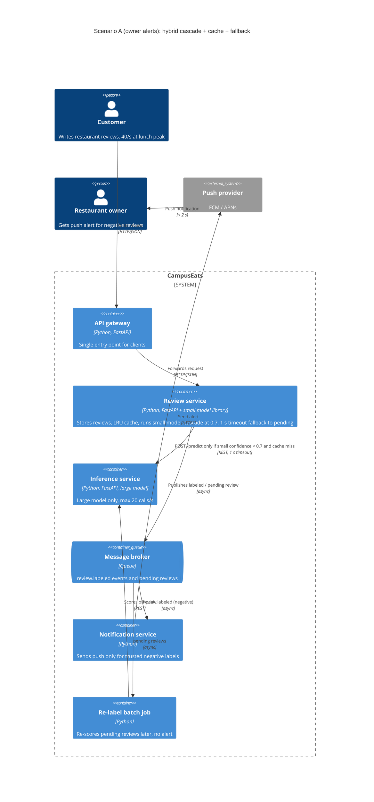

# Task 4: Deployment topologies and trade-offs

**Name / ชื่อ:** Santa

**Student ID / รหัสนิสิต:** 6732010421

This is **individual work**: each student completes and submits their own copy, in their own fork.

*งานนี้เป็น**งานเดี่ยว** นิสิตแต่ละคนทำและส่งงานของตัวเอง ใน fork ของตัวเอง*

**Scenario (A, B or C) / Scenario ที่เลือก:** A (Owner alerts). Student ID ends in 1 (odd) so A or B allowed.

Choose **one** scenario below. If the last digit of your student ID is odd, take A or B; if it is even, take B or C. Use your measurements from Tutorial 6 as evidence: cite run names from `results/runs.csv`. Answer in Thai or English.

เลือก scenario **หนึ่ง** ข้อด้านล่าง ถ้าเลขตัวสุดท้ายของรหัสนิสิตเป็นเลขคี่ ให้เลือก A หรือ B ถ้าเป็นเลขคู่ ให้เลือก B หรือ C ใช้ผลการวัดจาก tutorial ที่ทำไปเป็นข้อมูลอ้างอิง โดยอ้างชื่อ run จาก `results/runs.csv` จะตอบเป็นภาษาไทยหรือภาษาอังกฤษก็ได้

Facts that hold in every scenario / ข้อเท็จจริงที่ใช้กับทุก scenario:

- The large model serves at most **20 calls per second** (4 calls at once × about 200 ms each), and every call costs money.

  *large model รับได้สูงสุด **20 calls ต่อวินาที** (พร้อมกัน 4 calls × ประมาณ 200 ms ต่อ call) และทุก call มีค่าใช้จ่าย*
- The small model is fast and cheap enough to run anywhere, including inside the review service or on a kiosk, but it is much less accurate on its own.

  *small model เร็วและถูกพอที่จะรันที่ไหนก็ได้ รวมถึงภายใน review service หรือบน kiosk แต่ถ้าใช้ตัวเดียวจะแม่นน้อยกว่ามาก*

## Scenarios

**A. Owner alerts.** When a customer posts a negative review, the restaurant owner gets a push notification within **2 seconds**. At the lunch peak, CampusEats receives **40 reviews per second**. A missed alert is acceptable, but a wrong alert (for example, "your customer is unhappy" when they are happy) makes owners stop trusting alerts and, in the end, ignore them.

*เมื่อลูกค้าโพสต์รีวิวเชิงลบ เจ้าของร้านจะต้องได้รับ push notification ภายใน **2 วินาที** เวลาช่วงพีคตอนเที่ยง CampusEats ได้รับรีวิวจำนวน **40 รายการต่อวินาที** การพลาด alert ไปบ้างนั้นยอมรับได้ แต่ alert ที่ผิด (เช่น "ลูกค้าไม่พอใจ" ทั้งที่จริงๆ แล้วพอใจ) จะทำให้เจ้าของร้านไม่เชื่อถือและเลิกสนใจ alert ในที่สุด*

**B. Canteen kiosk.** A tablet in each canteen lets students leave a review on the spot. However, the canteen Wi-Fi is poor: the tablets lose their connection several times a day, for minutes at a time. The system must accept every review, even while a tablet is offline. Restaurant owners need the labels **by the end of the day**.

*มี tablet ในแต่ละโรงอาหารให้นิสิตรีวิวได้ทันที อย่างไรก็ดี การเชื่อมต่อ Wi-Fi ในโรงอาหารไม่ดี ทำให้ tablet หลุดการเชื่อมต่อวันละหลายครั้ง ครั้งละหลายนาที ระบบจะต้องรับรีวิวได้ทุกรายการแม้ขณะที่กำลัง offline อยู่ และเจ้าของร้านต้องการ label **ภายในสิ้นวัน***

**C. Weekly report.** Restaurant owners want a weekly sentiment report. Nothing in producing this report has to be real-time. **Accuracy matters most** and **cost must be minimal**.

*เจ้าของร้านต้องการรายงาน sentiment รายสัปดาห์ ไม่มีอะไรที่จะต้องทำแบบ real-time ในการออกรายงานนี้ ความแม่นยำ **(accuracy) สำคัญที่สุด** และ **ค่าใช้จ่ายต้องน้อยที่สุด***

## Topologies and patterns to choose from / Topology และ pattern ที่เลือกใช้ได้

| | Topology | Where the model runs / โมเดลรันที่ไหน |
|---|---|---|
| T1 | Model as a service, synchronous | Inference service, called for each review (today's baseline) *inference service ถูกเรียกทุกรีวิว (baseline ของวันนี้)* |
| T2 | Model as a library | Inside the review service, or on the device *ภายใน review service หรือบนอุปกรณ์* |
| T3 | Hybrid | Small model locally, large model as a remote service *small model รันในเครื่อง large model เป็น remote service* |
| T4 | Asynchronous / batch | Reviews are queued (broker, W10) or stored, and scored later in bulk *รีวิวถูกเข้าคิว (broker, W10) หรือเก็บไว้ แล้วติด label ทีหลังเป็นชุด* |

Combine one topology with any of the patterns from Tutorial 6: **fallback**, **cascade** and **cache**.

*เลือก topology หนึ่งแบบ แล้วผสมกับ pattern จาก Tutorial 6 ได้ตามต้องการ: **fallback**, **cascade** และ **cache***

## 1. Quality requirements

The three most important quality requirements for your scenario, each with a number where possible.

*quality requirements ที่สำคัญที่สุด 3 ข้อของ scenario ที่เลือก ระบุตัวเลขเมื่อทำได้*

| # | Quality | Requirement |
|---|---|---|
| 1 | Accuracy / precision of alerts | A negative alert must be correct; label accuracy at least 93% (close to large-only 93.5%), and only alert when the label is trustworthy. Missing an alert is OK, a wrong one is not. |
| 2 | Performance | Owner gets the push notification within 2 s of the review being posted, at the 40 reviews/s lunch peak. |
| 3 | Capacity / cost | Large model calls at peak must stay under 20 calls/s (aim for about 15/s to have headroom), and as few as possible since every call costs money. |

## 2. Design / การออกแบบ

Your topology, the patterns you add, and a container-level diagram (C4 level 2). The C4 diagram must be written in Mermaid.

*topology ที่เลือก pattern ที่เพิ่ม และ diagram ระดับ container (C4 level 2) เขียนด้วย Mermaid*

Topology: **T3 Hybrid**. The small model runs as a library inside the review service, the large model stays a remote inference service. Patterns: **cascade** (threshold 0.7), **cache** (LRU, key = model version + normalized text) in front of it, and **fallback** (1 s timeout, then save as pending, no alert). The notification is sent async from an event so posting the review isn't blocked. An alert is only sent if the final label is negative and it came from the large model or from a cached large/high-confidence answer; if we fall back to pending, we just skip the alert (missed alert is acceptable, wrong one is not).

## 3. Evidence / หลักฐาน

Which runs support your choice? Show the numbers and, for scenario A, the capacity arithmetic: how many large-model calls per second does your design need at the peak?

*run ไหนที่สนับสนุนการตัดสินใจของนิสิต ให้นิสิตแสดงตัวเลขประกอบ และสำหรับ scenario A ให้นิสิตแสดงการคำนวณ capacity ด้วย เพื่อแสดงว่าในช่วงพีคนั้น design ของนิสิตต้องใช้ large model กี่ calls ต่อวินาที*

| Run | What it shows / แสดงอะไร |
|---|---|
| t0-large | Large only: 93.5% acc but 100% large calls. 100% x 40 req/s = 40 calls/s, 2x over the 20/s limit, so T1 alone can't work at peak. |
| t0-small | Small only: 72.5% acc, way too many wrong alerts, even though p95 is 30 ms. |
| t2-0.7 | Cascade 0.7: 93.0% acc, 53% large calls. 53% x 40 = ~21 calls/s > 20/s, so cascade alone is still just over the limit. |
| t2-0.6 | Cascade 0.6: 38% large (15 calls/s) but acc 91.5%, more wrong alerts, so I don't want to lower the threshold to fix capacity. |
| t3-cache | Cascade 0.7 + cache: 93.0% acc kept, 35% cache hits, large calls 38%. 38% x 40 = 15.2 calls/s < 20/s (about 24% headroom). p50 6 ms, p95 564 ms, well under 2 s. |
| t1-after | Fallback: when large model hangs, 0 errors, 28 pending, p95 1006 ms. Still under 2 s, reviews are not lost, and we just skip alerts for pending ones. |

Capacity at peak: 40 req/s x 38% large calls (t3-cache) = **~15.2 large calls/s**, below the 20 calls/s limit. Without the cache: 40 x 53% = ~21 calls/s, over the limit.

## 4. ADR

Use the ADR format from W5.

*ใช้รูปแบบ ADR จาก W5*

**Title:** Use hybrid topology (small model in review service + remote large model) with cascade 0.7, LRU cache and timeout fallback for owner alerts

**Status:** Proposed

**Context:** Owners need a push alert for negative reviews within 2 s, at a peak of 40 reviews/s. Wrong alerts kill trust, missed alerts are OK. The large model is accurate (93.5%, t0-large) but only does 20 calls/s and costs money; sending everything to it needs 40 calls/s. The small model is fast (p95 30 ms) but only 72.5% accurate (t0-small). Cascade at 0.7 alone needs 53% x 40 = ~21 calls/s (t2-0.7), just over the limit.

**Decision:** Use T3 hybrid: the small model runs as a library in the review service, the large model stays a remote service. Check an LRU cache first (key = model version + normalized text), then run the cascade with threshold 0.7, calling the large model only for low-confidence reviews, with a 1 s timeout that falls back to pending. Publish labeled reviews to a broker; the notification service only alerts on negative labels, and pending reviews get re-labeled by a batch job with no alert.

**Consequences:**
- Positive: Large calls drop to about 38% x 40 = 15.2 calls/s (t3-cache), under the 20/s limit with some headroom and much cheaper than 100%. Accuracy stays 93.0%, almost the same as large-only. p50 6 ms and p95 564 ms (and 1006 ms with hangs, t1-after) fit the 2 s alert budget. A hung large model doesn't break posting (0 errors in t1-after).
- Negative: Headroom depends on the cache hit rate (35%); if lunch reviews are less repetitive, we go back to ~21 calls/s and need rate limiting or to send overflow to pending. The small model can still be confidently wrong (sarcasm, negation) and cause a wrong alert. More moving parts (cache invalidation on model update, broker, batch job), and pending reviews never get a real-time alert.

**Alternatives considered:** at least one topology you rejected, and why.

*อย่างน้อยหนึ่ง topology ที่ไม่เลือก และเหตุผล*

> T1 (sync large model for every review) rejected: needs 40 calls/s at peak, 2x the limit (t0-large), so requests would queue and blow the 2 s budget. T2 (small model only, as a library) rejected: fast but 72.5% accuracy (t0-small) means lots of wrong alerts, which is exactly what this scenario can't accept. T4 (pure async/batch) rejected as the main path because batching can't guarantee alerts within 2 s, but I still use it for re-labeling pending reviews. Also rejected just lowering the threshold to 0.6 (38% large, t2-0.6) because accuracy drops to 91.5% and that means more wrong alerts.
